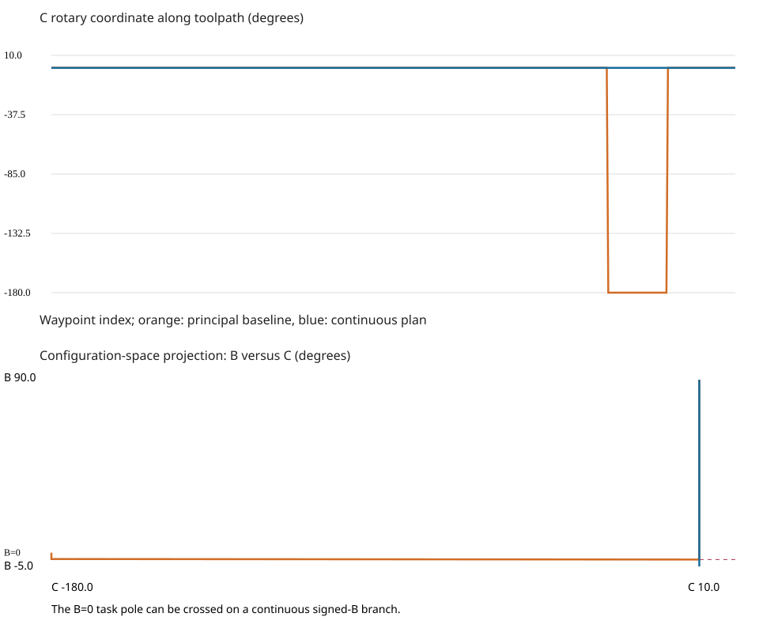

# Pneumatic tee fitting trajectory fixture

`machine.sg` models one five-axis head, a 40×28×24 mm finished fitting clearance
body, a 12 mm diameter X through bore, and a 16 mm diameter branch tilted 10°.
`toolpath.sg` retains operation names for intersecting-bore travel, angled-port
approach/drill/retract, an illustrative internal-junction chamfer center path,
and orientation changes at the explicitly supplied clearance waypoints.

The 448-pose fixture processes the same intended poses with the principal-angle
baseline and continuous planner. No stock removal or tool-contact claim follows
from naming a waypoint `cut`; the chamfer is a kinematic access fixture, not a
validated final bevel. Tooling/process dimensions need CAM and material-removal
validation before it becomes a physical machining process.

| Metric | Principal baseline | Continuous plan |
|---|---:|---:|
| Invalid connecting joint moves | 2 | 0 |
| C travel | 360° | 0° |
| Rotary direction reversals | 6 | 3 |
| Added retract/positioning moves | 0 | 0 |
| Sampled maximum tip deviation | 0.268779 mm | 0.002250 mm |
| Specified position corridor | 0.03 mm | 0.03 mm |
| Minimum task singular value | 0 | 0 |
| Sampled conservative clearance lower bound | 0.279003 mm | 0.279003 mm |

The minimum singular value remains zero because the path actually passes through
the pole. Continuing along its reachable meridian is preferable to a categorical
singularity refusal. The baseline has correct endpoints but violates the corridor
between them and therefore needs a manual post/branch repair. No dummy move was
added to inflate the baseline: the improvement is automatic removal of that need
for repair, not a measured removal of industrial dummy-positioning blocks.

`comparison.tsv` contains per-axis travel and reference peak velocities,
accelerations and jerks. `axis-trace.tsv` and `baseline-trace.tsv` provide actual
joint coordinates. `simulation.tsv` is the reference quintic time trace.
`configuration-space.svg` shows winding and the projected B/C trajectory.
`continuous.ngc` contains the LinuxCNC prototype output; `baseline-diagnostic.ngc`
contains only commented baseline words after M2 so its failed motions do not run.

See [the complete prototype contract](../../docs/cnc-prototype.md) before using
the input format or interpreting validation. Physical-machine acceptance is NOT_RUN.
