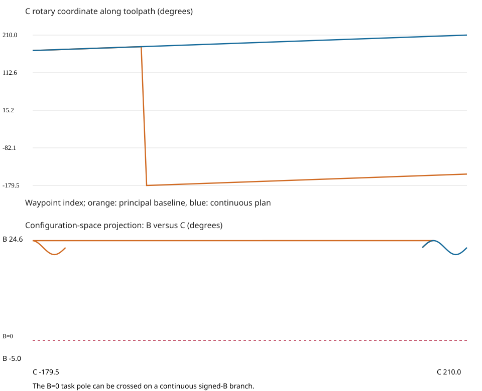

# Simultaneous motion fixture

A curved tool-center path changes tilt and crosses the principal C angle seam.
Its 81 waypoints increase C from 170° to 210° while XYZ and B also move. Roll is
unconstrained and the initial head joints are supplied by the machine description.

The baseline crosses from 180° to −179.5° and violates the interpolated geometry
on one edge. The continuous output retains C beyond 180°. C travel is reduced
from 399° to 40° without adding a move. This is a simultaneous motion fixture,
not evidence of a finished workpiece surface or cutting-time savings.

`comparison.tsv` includes all per-axis metrics; the G-code, joint and reference
time traces use the same conventions as the pneumatic-fitting example.

See [the prototype contract](../../docs/cnc-prototype.md). Controller simulation
and physical machining are NOT_RUN.
